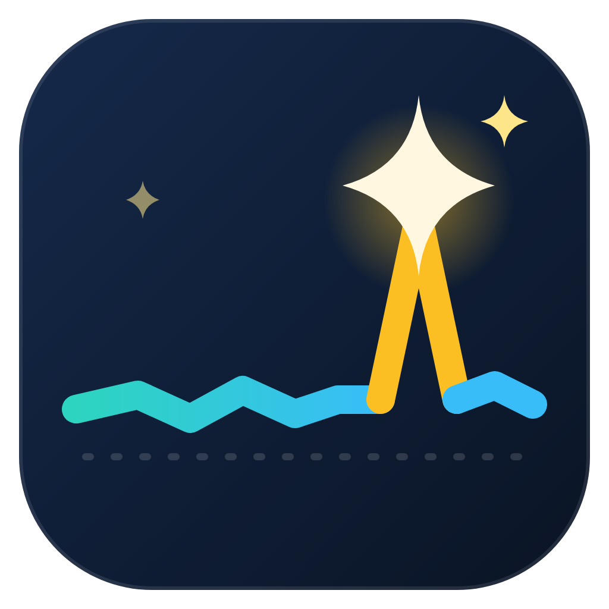
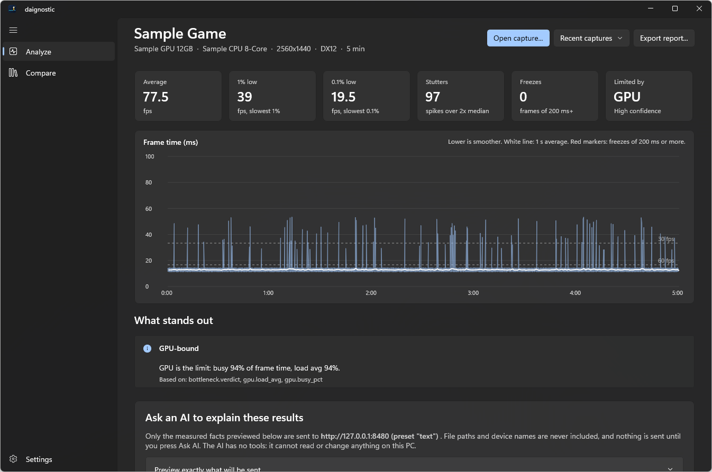
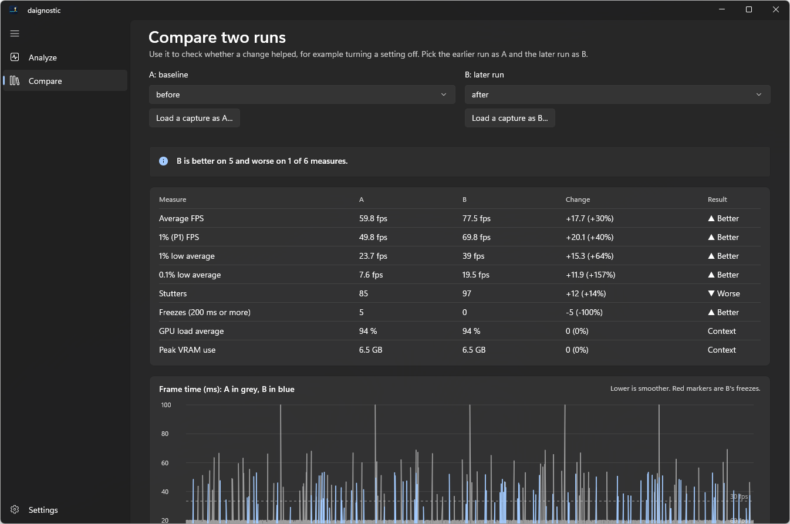

<p align="center">
  
</p>

<h1 align="center">daignostic</h1>

<p align="center">
  AI-assisted game performance diagnostics for Windows.<br>
  Open a <a href="https://github.com/CXWorld/CapFrameX">CapFrameX</a> capture, see what happened, and get a plain-language explanation you can trust.
</p>

> **Status: pre-release (0.1.0, MVP).** The app works and is tested, but there is no public release yet.

## What it does

You played a game and it stuttered. A capture tells you *that* it did; daignostic helps you work out *why*.

- **Analyze a capture.** Average FPS, 1% and 0.1% lows, stutters, freezes, and whether the GPU or CPU is the limit. A frame-time chart marks every freeze.
- **Explain it.** Rule-based findings cite the exact measurements they come from ("the GPU was busy during the freezes, and no drive passed 2% activity, so it is not disk streaming").
- **Compare two runs.** Changed a setting? See, measure by measure, whether it helped.
- **Ask an AI, safely.** Optionally send only the measured facts to an AI of your choice. You see the exact message first, the AI has no tools, and any claim that cites no evidence is thrown away.
- **Read your game's settings.** Currently Black Myth: Wukong, so findings can say "ray tracing is on while the game hitches".

| Analyze | Compare |
|---|---|
|  |  |

## Safe by design

- **Read-only.** daignostic reads capture files and game config files. It never edits game settings, starts captures, or runs commands. Anything it would write (a report) goes where *you* choose, through a save dialog.
- **Private by default.** Analysis is local. The AI step is optional, points at an endpoint you configure (a local gateway works), and never receives file paths or device names. Your API key is stored encrypted and is sent only to that endpoint.
- **Honest.** Hypotheses are labelled as hypotheses, and "inconclusive" is a valid answer.

Details: [docs/privacy.md](docs/privacy.md) and [ADR 0006](docs/adr/0006-read-only-by-design.md).

## Install

Pre-built downloads will appear on the [Releases](../../releases) page once the first version is published:

| Download | Use it when |
|---|---|
| `daignostic-<version>-win-x64.msix` | You want a normal install and updates. Needs the signing certificate trusted once; see [docs/releasing.md](docs/releasing.md). |
| `daignostic-<version>-portable-win-x64.zip` | You want no installation. Unzip anywhere and run `Daignostic.exe`. |

Requires Windows 10 (1809) or newer, x64. Nothing else needs to be installed.

## Quick start

1. Record a gameplay session with CapFrameX (it saves a `.json` capture).
2. Start daignostic and drop the capture on the window, or choose **Open capture...**.
3. Read **What stands out**. Open **Preview exactly what will be sent** if you want an AI explanation, then press **Ask AI**.
4. Change one setting in the game, record again, and use **Compare** to see if it helped.

More in the [user guide](docs/user-guide.md).

## AI setup (optional)

daignostic talks to any OpenAI-compatible `/v1/chat/completions` endpoint, for example a self-hosted gateway such as [xellter](https://github.com/axellageraldinc/xellter). In **Settings**, set the endpoint, the preset or model name, and (if required) an API key. The key is stored encrypted for your Windows account and is never written to the settings file.

## Build from source

```powershell
git clone https://github.com/axellageraldinc/daignostic
cd daignostic
dotnet test tests\Daignostic.Core.Tests          # unit tests
winapp run src\Daignostic                        # build, register and launch the app
```

You need the .NET 10 SDK, [WinApp CLI](https://github.com/microsoft/winappCli) 0.7+ and Windows Developer Mode. See [docs/development.md](docs/development.md) for UI tests and packaging.

## Documentation

| | |
|---|---|
| [User guide](docs/user-guide.md) | Using the app, reading the results |
| [Architecture](docs/architecture.md) | How the code is organised |
| [ADRs](docs/adr/README.md) | Technical decisions and why |
| [BDRs](docs/bdr/README.md) | Product decisions and why |
| [Privacy](docs/privacy.md) | Exactly what is read, stored and sent |
| [Development](docs/development.md) | Build, test, package |
| [Releasing](docs/releasing.md) | Release checklist, going public |
| [Contributing](CONTRIBUTING.md) | How to help |

## License

[MIT](LICENSE). daignostic is an independent project and is not affiliated with CapFrameX, NVIDIA or any game publisher.
